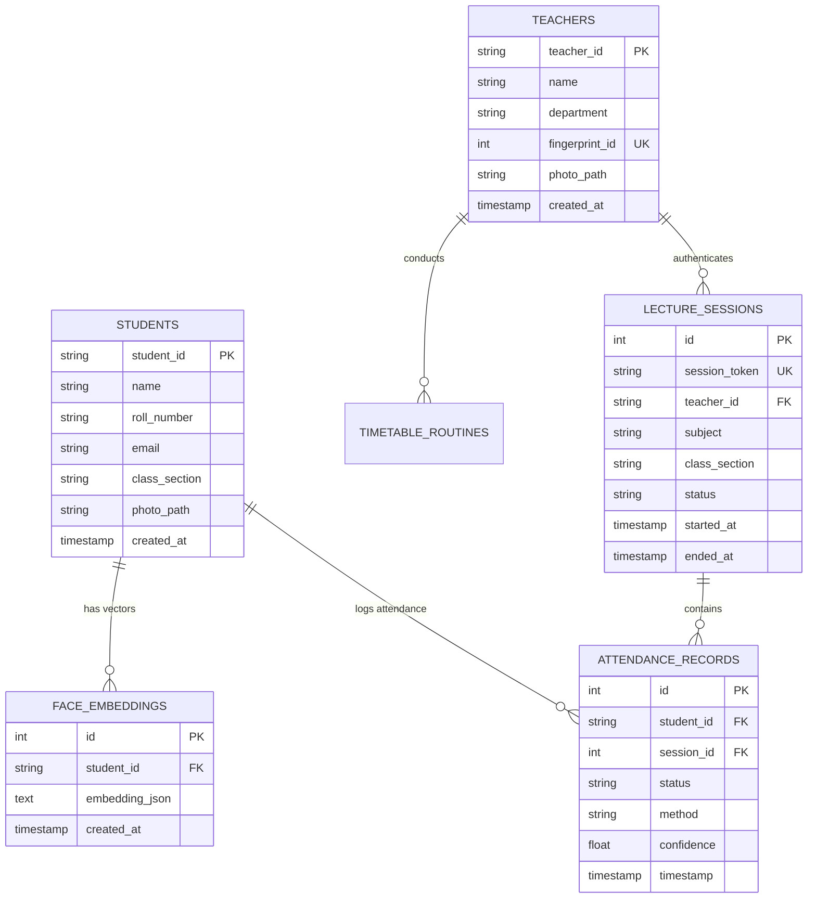

# Database Schema & Entity Relationships

The Attendance System leverages an ACID-compliant SQLite relational database with Foreign Key enforcement and Write-Ahead Logging (WAL) enabled.

## Pragma Optimizations
- `PRAGMA foreign_keys = ON;`
- `PRAGMA journal_mode = WAL;`
- `PRAGMA synchronous = NORMAL;`
