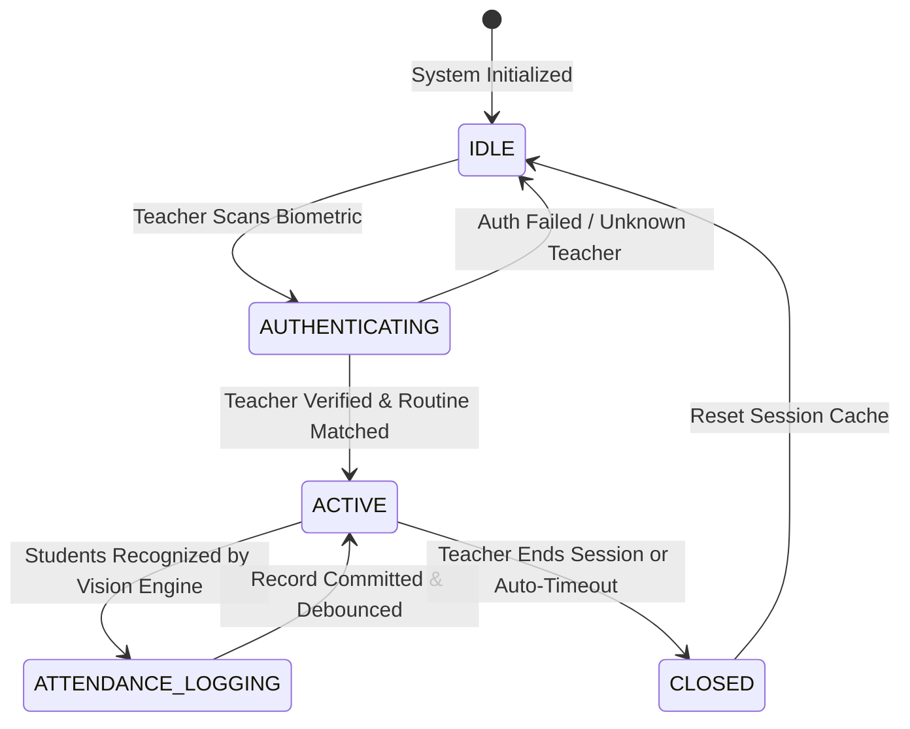

# Lecture Session Lifecycle & State Transitions

A lecture session must be authenticated via Teacher Fingerprint or Faculty Face Recognition before attendance logging is unlocked.

## Security Guarantees
- Attendance cannot be marked without an ACTIVE session.
- Student double-marking is locked via monotonic timestamp cooldowns.
